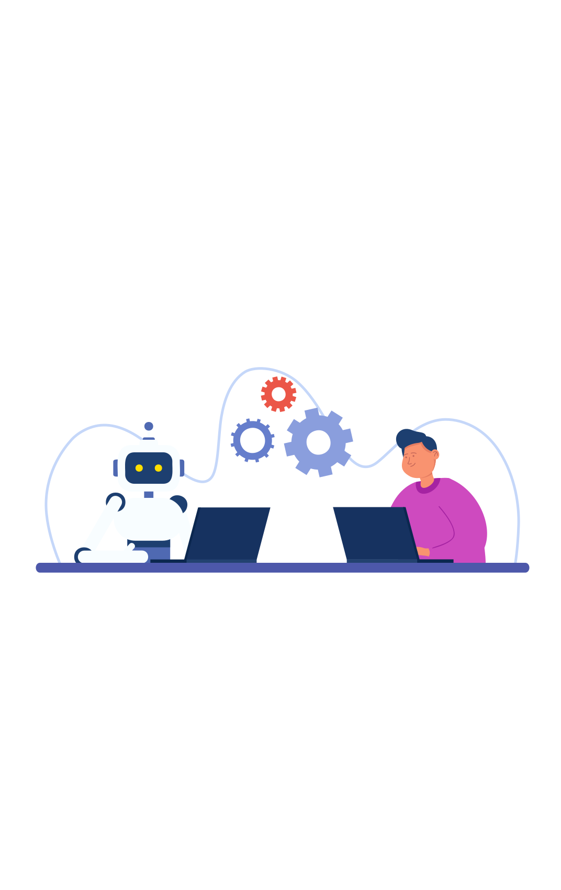

<div align="center">

<picture>
  <source media="(prefers-color-scheme: dark)" srcset="./dark.svg">
  <source media="(prefers-color-scheme: light)" srcset="./light.svg">
  
</picture>

</div>

## 👋 Hi, I'm Naeem

Software engineer who wants to **build full-stack web apps and secure them**.

## 🎯 About Me

<table width="100%">
<tr>
<td width="58%" valign="top">

```js
const naeem = {
  role: "Software Engineer",

  focus: [
    "Web Security (VAPT)",
    "Full-Stack Development",
  ],

  building: [
    "Textile ERP Management System",
  ],

  learning: [
    "Programming Hero - Next Level Course",
  ],

  completed: [
    "Creative IT - Ethical Hacking",
    "Programming Hero - Level 1",
  ],

  tech: {
    languages: ["TypeScript", "JavaScript", "Bash"],
    frontend: ["React", "Next.js", "Tailwind", "HTML5", "CSS3"],
    backend: ["Node.js", "Express", "NestJS"],
    database: ["MongoDB", "Prisma", "PocketBase"],
    devops: ["Docker", "AWS", "Nginx", "Vagrant"],
    tools: ["Git", "GitHub", "GitHub Actions", "Postman"],
    security: [
      "Kali Linux", "Burp Suite", "Wireshark",
      "Metasploit", "OWASP ZAP", "Nmap",
    ],
  },

  goal: "Build full-stack apps and secure the web",
};
```

</td>
<td width="42%" align="center" valign="middle">



</td>
</tr>
</table>

## 🛠️ Tech Stack

**Development**

<table align="center">
<tr>
<td align="center" width="96"><br><sub><b>TypeScript</b></sub></td>
<td align="center" width="96"><br><sub><b>JavaScript</b></sub></td>
<td align="center" width="96"><br><sub><b>HTML5</b></sub></td>
<td align="center" width="96"><br><sub><b>CSS3</b></sub></td>
<td align="center" width="96"><br><sub><b>Bash</b></sub></td>
<td align="center" width="96"><br><sub><b>React</b></sub></td>
<td align="center" width="96"><br><sub><b>Next.js</b></sub></td>
<td align="center" width="96"><br><sub><b>Node.js</b></sub></td>
</tr>
<tr>
<td align="center" width="96"><br><sub><b>Express</b></sub></td>
<td align="center" width="96"><br><sub><b>NestJS</b></sub></td>
<td align="center" width="96"><br><sub><b>Tailwind</b></sub></td>
<td align="center" width="96"><br><sub><b>MongoDB</b></sub></td>
<td align="center" width="96"><br><sub><b>Prisma</b></sub></td>
<td align="center" width="96"><br><sub><b>PocketBase</b></sub></td>
<td align="center" width="96"><br><sub><b>Docker</b></sub></td>
<td align="center" width="96"><br><sub><b>AWS</b></sub></td>
</tr>
<tr>
<td align="center" width="96"><br><sub><b>Nginx</b></sub></td>
<td align="center" width="96"><br><sub><b>Postman</b></sub></td>
<td align="center" width="96"><br><sub><b>Vagrant</b></sub></td>
<td align="center" width="96"><br><sub><b>Git</b></sub></td>
<td align="center" width="96"><br><sub><b>GitHub</b></sub></td>
<td align="center" width="96"><br><sub><b>GH Actions</b></sub></td>
</tr>
</table>

**Ethical Hacking / Security Tools**

<table align="center">
<tr>
<td align="center" width="96"><br><sub><b>Kali Linux</b></sub></td>
<td align="center" width="96"><br><sub><b>Burp Suite</b></sub></td>
<td align="center" width="96"><br><sub><b>Wireshark</b></sub></td>
<td align="center" width="96"><br><sub><b>Metasploit</b></sub></td>
<td align="center" width="96"><br><sub><b>OWASP ZAP</b></sub></td>
<td align="center" width="96"><br><sub><b>Nmap</b></sub></td>
</tr>
</table>

## 🚀 Featured

| Project | Description |
| --- | --- |
| [merchflow-app](https://github.com/naeemislamofficiall-dev/merchflow-app) | TypeScript project |
| [jangow-vapt-report](https://github.com/naeemislamofficiall-dev/jangow-vapt-report) | VAPT report |

## 🎓 Learning

- **Creative IT**: Ethical Hacking (completed)
- **Programming Hero**: Level 1 completed, Next Level course in progress

## 📫 Connect With Me

<div align="center">

[](https://github.com/naeemislamofficiall-dev)
[](https://www.linkedin.com/in/YOUR_LINKEDIN_USERNAME)
[](https://www.facebook.com/YOUR_FACEBOOK_USERNAME)
[](https://wa.me/YOUR_NUMBER_WITH_COUNTRY_CODE)

</div>
